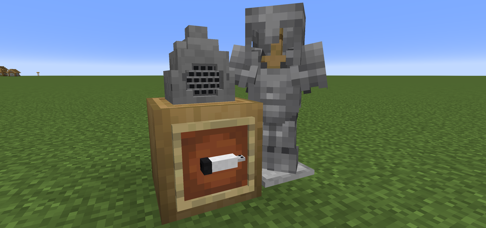
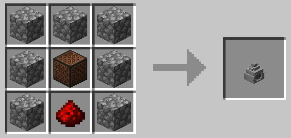
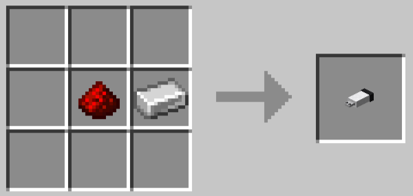
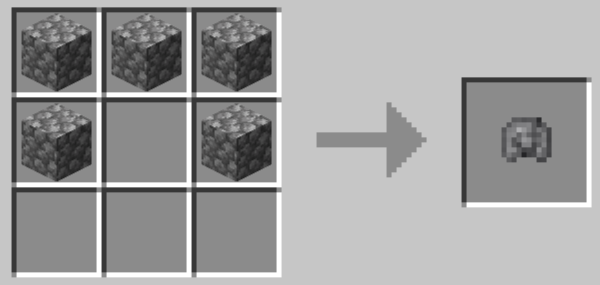
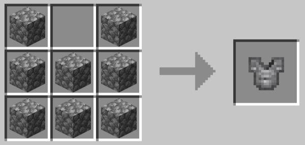
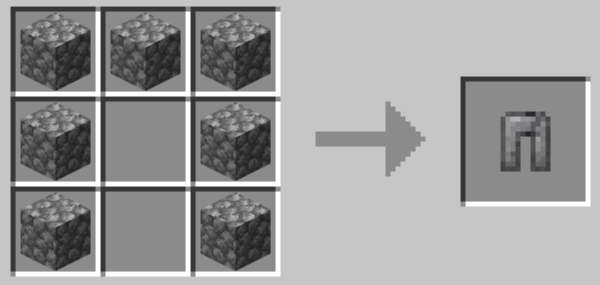
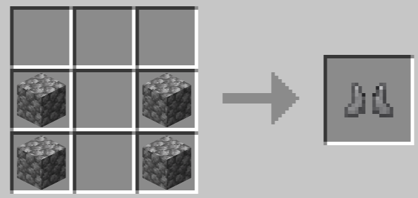

# Explanation Stone




A NeoForge 1.21.1 mod: a stone that plays music, a USB drive that stores playlists, and a cobblestone armor set.

## Contents

- **Explanation Stone**: a music-playing stone, crafted from a note block, cobblestone and redstone dust
- **USB Drive**: crafted from an iron ingot + redstone dust; right-click air to edit the playlist (select, reorder, play mode, right-click/redstone mode), right-click the stone to insert it; drop `.ogg` files into `config/explainationstone/music/`
- **Raw Stone Armor**: crafted from cobblestone


|Item|Recipe|
|-|-|
|Explanation Stone||
|USB Drive||
|Raw Stone Helmet||
|Raw Stone Armor||
|Raw Stone Leggings||
|Raw Stone Boots||

## Build

```bash
gradlew build      # output: build/libs/explainationstone-0.1.0.jar
gradlew runClient  # dev client
```

Requires JDK 21 and NeoForge 21.1.209.

## License

MIT
Audio decoding uses [vorbis-support](https://github.com/Trilarion/vorbis-support) (LGPL-2.1, bundled into the jar).
