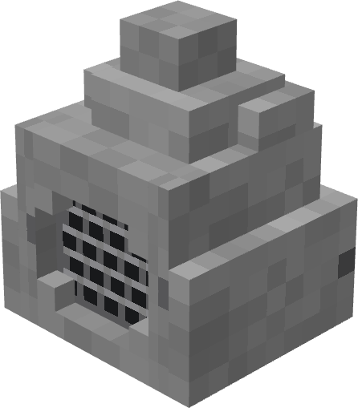

# Explanation Stone（讲解石）



NeoForge 1.21.1 模组：一块会放音乐的石头，一个存歌单的 U 盘，还有一套原石铠。

## 内容

- **讲解石**：右键或红石信号播放音乐，信号消失/方块被破坏立即停止
- **U 盘**：右键空气编辑歌单，右键讲解石插入播放；曲库放 `config/explainationstone/music/*.ogg`
- **原石铠**：圆石合成
- **讲解石配方**：3×3 工作台，外围圆石、中间音符盒、下方红石粉；拿到圆石后自动解锁

## 构建

```bash
gradlew build      # 产物 build/libs/explainationstone-0.1.0.jar
gradlew runClient  # 开发客户端
```

需要 JDK 21、NeoForge 21.1.209。

## 许可证

MIT。音频解码使用 [vorbis-support](https://github.com/Trilarion/vorbis-support)（LGPL-2.1，已打包进 jar）。

模型与贴图由 Mcking 制作（Blockbench）。
