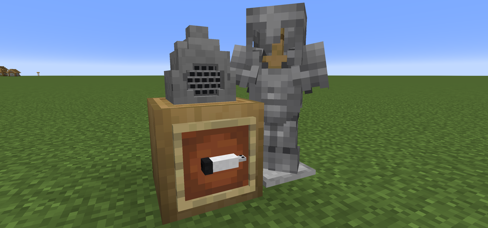
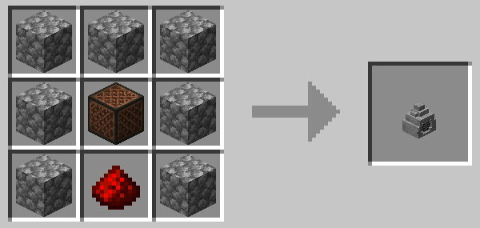
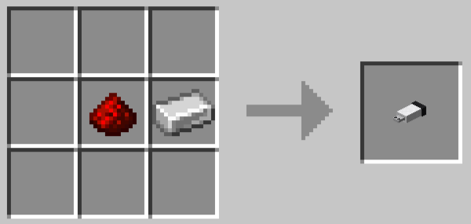
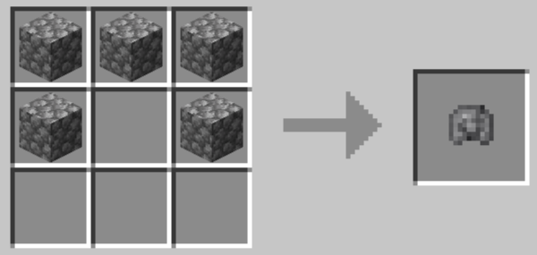
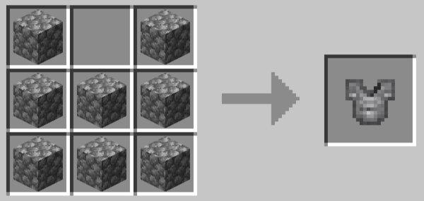
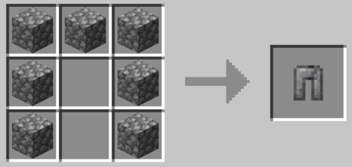
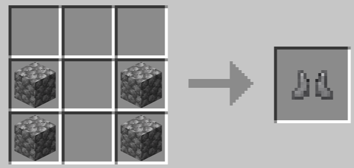

# Explanation Stone（讲解石）




NeoForge 1.21.1 模组：一块会放音乐的石头，一个存歌单的 U 盘，还有一套原石铠。

## 内容

- **讲解石**：播放音乐的石头，使用音符盒、原石和红石粉合成
- **U 盘**：铁锭 + 红石粉合成；右键空气编辑歌单（勾选、排序、播放模式、右键/红石模式），右键讲解石插入；曲库放 `config/explainationstone/music/*.ogg`
- **原石铠**：圆石合成


|物品|配方|
|-|-|
|讲解石||
|U盘||
|原石头盔||
|原石铠||
|原石护腿||
|原石靴子||

## 构建

```bash
gradlew build      # 产物 build/libs/explainationstone-0.1.0.jar
gradlew runClient  # 开发客户端
```

需要 JDK 21、NeoForge 21.1.209。

## 许可证

MIT
音频解码使用 [vorbis-support](https://github.com/Trilarion/vorbis-support)（LGPL-2.1，已打包进 jar）。
