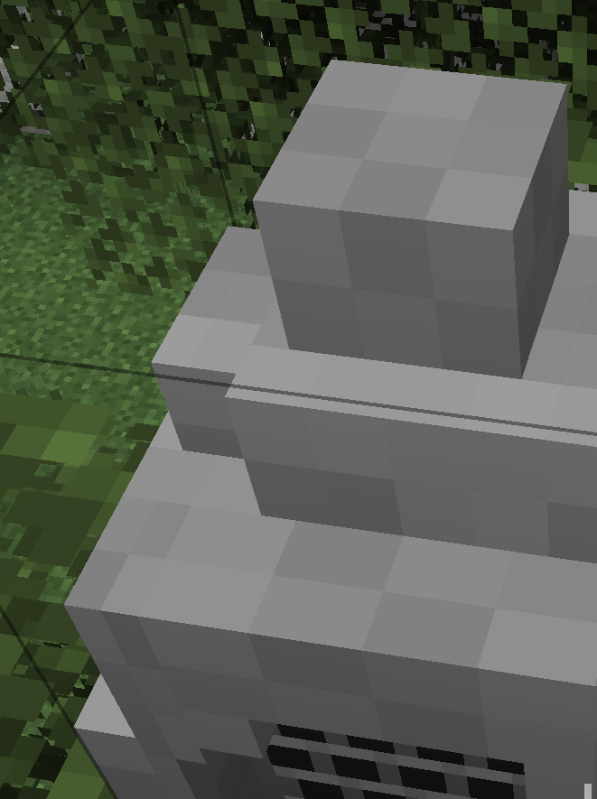
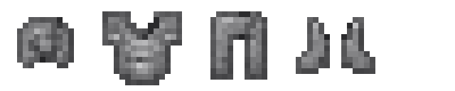
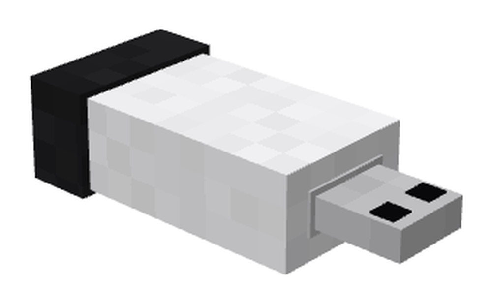

# Explanation Stone（讲解石）

一个 NeoForge 1.21.1 的装饰/音乐向模组：把石头音响做成方块，配一套「原石铠」护甲，以及一个可以把歌单插进讲解石的 U 盘。

> A NeoForge 1.21.1 mod: a stone speaker block, a cobblestone armor set, and a USB drive that stores playlists and plugs into the speaker.



| 原石铠 | U 盘 |
|---|---|
|  |  |

## 功能

### 讲解石（Explanation Stone）

- 方块 `stonespeaker:stone_speaker`，模型在 Blockbench 中制作（17 个 cube、4 张 16×16 贴图）
- 有朝向：放置时面朝玩家，支持四个方向
- **右键 / 红石信号** 播放音乐：有信号播放、没信号停止；破坏方块立即停止
- 空手右键：有歌单播歌单，没有就播默认的 `music.ogg`
- 物品栏里是等距 3/4 预览；破坏粒子使用石头贴图

### 原石铠（Raw Stone Armor）

| 部件 | 防御 | 配方（圆石） |
|---|---|---|
| 原石头盔 | 2 | 5 个 `XXX / X X` |
| **原石铠**（胸甲） | 5 | 8 个 `X X / XXX / XXX` |
| 原石护腿 | 4 | 7 个 `XXX / X X / X X` |
| 原石靴子 | 1 | 4 个 `X X / X X` |

耐久倍率 12，附魔值 12，可用圆石修复；贴图由下界合金盔甲重绘成石灰色。

### 合成讲解石

**唱片机 + 任意一件原石铠**（无序合成）→ 讲解石。

### U 盘与歌单

- 物品 `stonespeaker:usb_drive`，3D 模型（Blockbench）
- 曲库目录：`config/stonespeaker/music/`，放入 `.ogg` 文件即可（首次启动会自动复制内置音乐为 `music.ogg`）
- **右键空气** 打开歌单界面：列出曲库曲目，点击 `[ ] / [x]` 加入或移出歌单，Done 保存到 U 盘
- **右键讲解石**：把 U 盘歌单写入讲解石并开始播放
- 播放为客户端纯 Java 解码（[vorbis-support](https://github.com/Trilarion/vorbis-support) + Java Sound），**支持任意 OGG，无需资源包、无需重启**
- 音量按距离 0–64 格线性衰减；多首按顺序播放；每个方块独立播放/停止

## 环境要求

| 项 | 版本 |
|---|---|
| Minecraft | 1.21.1 |
| NeoForge | 21.1.209（可在 `gradle.properties` 修改） |
| JDK | 21 |
| Gradle | 8.12（自带 wrapper） |

## 构建与运行

```bash
# 构建
./gradlew build          # Windows: gradlew.bat build

# 启动开发客户端
./gradlew runClient
```

产物：`build/libs/stonespeaker-0.1.0.jar`，可直接放进 1.21.1 NeoForge 的 `mods/` 目录。

用 IDEA 打开项目时，Project SDK 选 21；`gradle.properties` 已固定 Gradle 使用的 JDK。

## 开发说明

### 模型

- 讲解石模型：`src/main/resources/assets/stonespeaker/models/block/stone_speaker.json`
- U 盘模型：`src/main/resources/assets/stonespeaker/models/item/usb_drive.json`
- 从 Blockbench 重新导出后运行 `python tools/normalize-model.py`，会把 `format_version` 改成 `1.21.1`、补上贴图命名空间/`parent`/`particle`

### 网络与镜像

`maven.neoforged.net` 在国内基本不可达，本项目已处理：

| 用途 | 仓库 |
|---|---|
| NeoForge 依赖 / NFRT 工具链 | `https://neoforged.forgecdn.net/releases`（官方 maven 的 CDN 镜像） |
| 兜底 | `https://bmclapi2.bangbang93.com/maven`、`tools/local-maven` |
| Gradle 本体 | 腾讯镜像 `mirrors.cloud.tencent.com/gradle/` |

`settings.gradle` 用 `gradle.beforeProject` 把镜像仓库注册在最前面，避免先请求被墙的官方地址。

## 项目结构

```
src/main/java/com/mcking/stonespeaker/
  StoneSpeaker.java          方块 / 物品 / 盔甲材质 / 网络包注册
  SpeakerBlockEntity.java    讲解石保存的 U 盘歌单
  UsbDriveItem.java          U 盘物品
  UsbLibrary.java            扫描 config/stonespeaker/music
  UsbScreen.java             歌单编辑界面
  ModComponents.java         U 盘歌单数据组件
  *Payload.java              网络包（保存歌单 / 播放 / 停止）
  client/
    ClientPlayback.java      OGG 解码与播放、距离衰减
    ClientSetup.java         首次启动复制内置音乐
    ClientHooks.java / ClientTicker.java

src/main/resources/
  META-INF/neoforge.mods.toml
  assets/stonespeaker/        模型、贴图、语言、sounds.json
  data/stonespeaker/recipe/   盔甲与讲解石配方
```

## 已知限制

- 播放解码在客户端本地完成；多人游戏中其他玩家需要本地也有同名 OGG 才能听到
- `vorbis-support` 目前是开发依赖，正式发布前需要用 `jarJar` 打包进 jar
- 歌单界面目前只显示前 10 首，后续可加翻页

## 许可证

MIT，见 [LICENSE](LICENSE)。

模型与贴图由 Mcking 制作（Blockbench），代码使用 NeoForge / Minecraft 官方映射。
